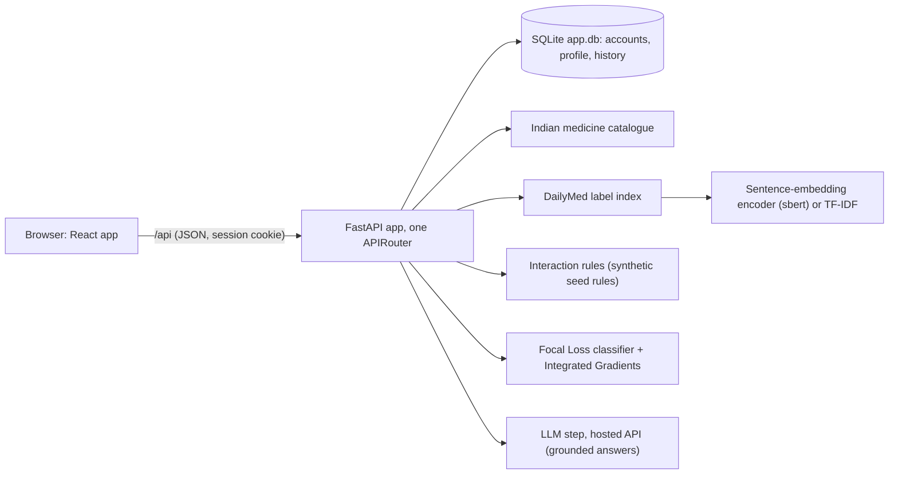

# Medopic: AI-Powered Personalized Medication Safety and Decision Support System

## 1. Project

Course 24RM604, Group 4. Partner: Selvam Medicals. Guide: Dr. T. Senthil Kumar.

The app helps a person keep track of their medicines and check a new one before taking it. A user signs in, enters a profile (age, height, weight), allergies, conditions and the medicines they take now or took before, and sees them as lists and timelines. To add a medicine they type its name or scan a printed prescription. The app then checks the new medicine against the current ones and the recorded allergies, shows a level (Medium, High or Critical) with the reason, asks for an acknowledgement when the level is Critical, and lists other brands with the same ingredients and their prices. A user can also search the US label text of a medicine and ask a question about it; the answer is written from the label passages and shows its sources, and questions about price or alternatives are answered from the same-ingredient list. An interaction-type estimate (from a trained classifier) with a word-level explanation is shown as supporting evidence and never changes a level. Every result is informational. See the [disclaimer](#11-disclaimer).

## 2. Features

| What a user can do | Page | API route |
|---|---|---|
| Sign in or create an account (a new email creates one), log out | `/login` | `POST /api/auth/login`, `POST /api/auth/logout`, `GET /api/auth/me` |
| Keep a profile (name, date of birth, sex, height, weight, blood group) and see BMI | `/profile` | `GET`/`PUT /api/profile`, `GET /api/profile/overview` |
| Record allergies | `/profile` | `/api/allergies` (GET, POST, PUT, DELETE) |
| Record past and current conditions, with outcome | `/history` | `/api/conditions` |
| Record past and current medicines; list, timeline and table views | `/history?tab=medicines` | `/api/medicine-records` |
| Add a medicine by typing; see label text for it | `/add` | `GET /api/medicine/suggest`, `GET /api/medicine/{id}/details` |
| Add medicines by scanning a printed prescription (text is read in the browser; no image is sent to the server) | `/add?tab=scan` | none for the picture; suggestions use `GET /api/medicine/suggest` |
| Risk analysis of the new medicines against current medicines and allergies, with the Critical acknowledgement | `/add` | `POST /api/analyze`, `POST /api/medicine-records/batch` |
| Find other brands with the same ingredients, with price and pack size | `/alternatives` | `GET /api/medicine/{id}/alternatives` |
| See medicines with similar uses | `/alternatives` | `GET /api/medicine/{id}/similar-use` |
| Search the US label text of a medicine | `/medicine/:id` | `POST /api/search/labels`, `GET /api/medicine/{id}` |
| Read a US label | `/label/:setId` | `GET /api/label/{set_id}`, `GET /api/label/{set_id}/alternatives` |
| Check several medicines against each other | `/checker` | `POST /api/checker` |
| Delete the account and all its data | `/account` | `DELETE /api/account` |
| Read what data and methods the app uses | `/about/data`, `/about/trace` | `/api/datasets/*`, `/api/catalogue/*`, `/api/appms/*`, `/api/index/summary`, `/api/ddi/metrics`, `/api/status`, `/api/trace` |

## 3. Architecture

A React app (Vite) talks to a FastAPI app that lives under `/api`. Accounts, profiles and medical history are stored in a local SQLite file. Medicine names, prices and compositions come from an Indian medicine catalogue; label text for ingredients comes from DailyMed. Risk levels come from interaction rules and allergy matching; the trained classifier only adds an interaction-type estimate and never changes a level.



The label index can use a sentence-embedding encoder (`ENCODER=sbert`) or the TF-IDF baseline. The classifier checkpoint and the label index are generated files and are not in git (section 6). The LLM step runs only when `LLM_API_KEY` is set and never sets a risk level or a price.

## 4. Requirements

Versions on the machine where everything below was run:

| Item | Version |
|---|---|
| OS | Windows 11 Home Single Language, 10.0.26300 |
| Python | 3.11.0 |
| Node.js | v24.11.0 (npm 11.6.1) |
| Browser for the browser scripts | Chromium installed by Playwright (`npx playwright install chromium`) |

Python packages are pinned in [aakaash/requirements.txt](aakaash/requirements.txt). Training the classifier also needs `torch` and [aakaash/requirements-train.txt](aakaash/requirements-train.txt).

## 5. Setup and run

Commands are for PowerShell on Windows, run from the repository root unless a `cd` is shown. Clone into a folder with a short path: `python -m venv` failed with "ensurepip returned non-zero exit status 1" when the clone was about 230 characters deep (Windows path-length limit), and worked at `C:\Users\<name>\AppData\Local\Temp\rmfresh`.

Backend:

```powershell
cd aakaash
python -m venv .venv
.venv\Scripts\python.exe -m pip install -r requirements.txt
$env:SESSION_SECRET = "<a long random string>"
.venv\Scripts\python.exe -m uvicorn api.app:app --port 8000
```

Frontend (second terminal):

```powershell
cd aakaash\web
npm ci
npm run dev
```

`npm run dev` starts both the API (port 8000, using `aakaash\.venv`) and the Vite dev server, so the backend step above is only needed if you want to run the API alone. The API takes about 15 s to be ready when the sbert encoder is on.

Open <http://localhost:5173> (if that port is busy, Vite prints the one it picked). The dev server forwards `/api` to <http://127.0.0.1:8000>; to use another API address set `MEDSAFE_API` before `npm run dev` (for example `$env:MEDSAFE_API = "http://127.0.0.1:8001"`). The API documentation is at <http://127.0.0.1:8000/docs>.

Production build and preview (the preview also forwards `/api`):

```powershell
cd aakaash\web
npm run build
npm run preview        # http://localhost:4173
```

Tests and checks (the API must be running on port 8000 for the browser scripts, and the data and indexes from section 6 must exist):

```powershell
cd aakaash
.venv\Scripts\python.exe -m pytest                  # API and parser tests
cd web
npm test                                            # parser and chart-layout tests (node --test)
npm run typecheck
npm run build
npx playwright install chromium                     # once
npm run e2e                                         # login to logout in headless Chrome
npm run visual                                      # overflow, fonts and clipped chart text at 1280 and 390 px, light and dark
npm run a11y                                        # axe-core and a keyboard-only run
```

The browser scripts take the web address as an argument and default to `http://localhost:4173` (the preview). For the dev server: `node scripts/e2e.mjs http://localhost:5173`.

Regenerate the TypeScript API types after changing the API:

```powershell
cd aakaash\web
npm run gen:types      # writes src/features/aakaash/api-types.ts from the FastAPI OpenAPI schema
```

Test results on this machine (main working copy, with `torch`, `transformers` and `captum` installed): `pytest` 371 passed, `npm test` 39 passed, typecheck and build clean, `npm run e2e` 38 passed. The classifier was trained on a Kaggle T4 GPU (`notebooks/train_ddi.ipynb`) and the sbert index was built on a Kaggle T4 (`notebooks/build_sbert_index.ipynb`).

## 6. Data

Nothing in `data/` is in git (`.gitignore` covers `data/`, `aakaash/artifacts/`, databases, model files, `.env` and key files). The folder `data/` sits at the repository root, next to `aakaash/` and `.git`.

| Folder | What to put there | Where it comes from |
|---|---|---|
| `data/indian_meds/` | `indian_medicine_data.csv` and `updated_indian_medicine_data.csv` | The public GitHub repository "Indian-Medicine-Dataset" (MIT licence as stated by the repository; the repository does not state where its data came from) |
| `data/dailymed_rx/` | One or more `dm_spl_release_human_rx_part*.zip` | DailyMed human prescription label downloads. Only part 6 (1.87 GB) was used here; the build loops over whatever zips are present |
| `data/ddi2013/` | The DDI Extraction 2013 corpus (`DDICorpus/Train`, `DDICorpus/Test`) | DDI Extraction 2013 shared task |
| `data/appms/` | `patients.csv`, `medications.csv`, `patient_drug_pair_scenarios.csv`, `ddi_seed_rules.csv`, `data_dictionary.csv`, `README.txt` | The Tamil Nadu and Kerala synthetic medication safety dataset supplied for the project. All patients and the interaction rules are synthetic |
| `data/tac2017/`, `data/mappings/` | Optional. Empty on this machine | TAC 2017 labels and DailyMed RxNorm mappings; not used by the app |

Build the indexes (all outputs go to `aakaash/artifacts/`, which is not in git). Run in this order from `aakaash`:

```powershell
.venv\Scripts\python.exe scripts\build_names.py        # name index: artifacts\names.json
.venv\Scripts\python.exe scripts\build_catalogue.py    # catalogue: artifacts\catalogue.json
.venv\Scripts\python.exe scripts\build_index.py        # label retrieval index (TF-IDF): artifacts\index\
```

Measured on this machine with the part 6 zip (4,293 labels) and 253,973 catalogue rows. Two runs each: the first in the main working copy with the files already in the disk cache, the second in a fresh clone with cold files.

| Step | Time (main copy / fresh clone) | Output size | Source of the number |
|---|---|---|---|
| `build_names.py` | 34.5 s / 55.8 s | 4.02 MB | printed by the script |
| `build_catalogue.py` | 13.9 s / 19.0 s | 18.71 MB | printed by the script |
| `build_index.py` | 58.0 s / 104.1 s, peak RAM 355.6 MB / 311.0 MB | 266.6 MB | printed by the script |

Build `names.json` and then `catalogue.json` again after any change to `medsafe/spl.py`. The API also needs the folders `data/appms` and `data/indian_meds`; without the catalogue it reports "not ready" on the affected pages. The database `artifacts/app.db` is created on first start. `python data_report.py` rewrites `aakaash/DATASET_REPORT.md` from the real files (59 s here).

## 7. Environment variables

At startup the API server loads `aakaash/.env` if it exists (python-dotenv). Variables already set in the real environment win over the file; a missing file is ignored. Copy [aakaash/.env.example](aakaash/.env.example) to `aakaash/.env` and fill in values. `.env` is gitignored; never commit values.

| Name | Purpose | Required |
|---|---|---|
| `SESSION_SECRET` | Key that signs the session cookie. If unset, a random key is made per run and everyone is signed out at each restart | Recommended |
| `MEDSAFE_COOKIE_SECURE` | Set to `1` to force the Secure cookie flag when TLS ends at a proxy (the flag is on automatically for https requests) | No |
| `MEDSAFE_API` | Address the web dev server and preview forward `/api` to. Default `http://127.0.0.1:8000` | No |
| `MEDSAFE_DATA_DIR` | Data folder. Default `<repo>/data` | No |
| `MEDSAFE_ARTIFACTS_DIR` | Output folder. Default `aakaash/artifacts` | No |
| `ENCODER` (or `MEDSAFE_ENCODER`) | `tfidf` (default) or `sbert`. `sbert` needs the index from `notebooks/build_sbert_index.ipynb` installed with `scripts/install_sbert.py`; if it is missing or stale the app answers with TF-IDF and says so | No |
| `MEDSAFE_DEVICE` | Device for the sbert model: `cpu` (default), `cuda` or `auto`. Used by the app, by `scripts/build_index.py` (or its `--device`) and by the scripts; tests never use a GPU | No |
| `MEDSAFE_DDI_CLASSIFIER` | Which classifier run to load: `focal` (default) or `ce` | No |
| `MEDSAFE_DDI_MODEL_DIR`, `MEDSAFE_DDI_METRICS_DIR` | Override where the classifier checkpoint and metrics are read | No |
| `MEDSAFE_DDI_IG_STEPS` | Integrated Gradients steps for explanations (default 50) | No |
| `SIMILAR_USE_MIN` | Minimum similarity for "similar uses"; unset means no minimum | No |
| `LLM_API_KEY` | Key for the hosted LLM (a Google AI Studio key). Server-side only; never sent to the browser, logged or committed. Unset: the AI-written answers are hidden and the rest of the app works | No |
| `LLM_PROVIDER` | Which provider class to use. Default `gemini` | No |
| `LLM_MODEL` | Model name. Default `gemini-3.5-flash-lite` (listed Stable on Google's models page, checked 2026-11-04) | No |
| `LLM_RPM` | Requests per minute the server allows itself. Default 5. Free-tier limits per model are shown only in Google AI Studio; check yours before raising it | No |

## 8. Project layout

```
.gitignore
README.md                 this file
data/                     datasets (not in git)
aakaash/
  api/                    FastAPI app: app.py (standalone app), router.py (one APIRouter, prefix /api), auth.py, db.py, schemas.py, services/
  medsafe/                parsers (SPL labels, DDI 2013), catalogue, risk rules, chunking, encoders, index, classifier, explanations
  scripts/                build_names / build_catalogue / build_index, evaluations, training, spl_check/
  tests/                  pytest tests (fixtures are hand-written, not real data)
  notebooks/              train_ddi.ipynb (GPU training of the classifier)
  web/                    React app: src/, scripts/ (e2e, visual-check, a11y, gen-types), DESIGN.md
  artifacts/              generated files and app.db (not in git)
  CLAUDE.md, WEBAPP_PLAN.md, PAPER_TRACE.md, DATASET_REPORT.md   project notes
```

## 9. API overview

All routes are under `/api`. Interactive documentation: <http://127.0.0.1:8000/docs>; schema: <http://127.0.0.1:8000/openapi.json>.

| Group | Routes | Needs sign-in |
|---|---|---|
| Account | `/auth/login`, `/auth/logout`, `/auth/me`, `DELETE /account` | all but login |
| Profile and history | `/profile`, `/profile/overview`, `/allergies`, `/conditions`, `/medicine-records`, `/medicine-records/batch` | yes |
| Risk analysis | `POST /analyze` | yes |
| Medicines | `/medicine/suggest`, `/medicine/{id}`, `/medicine/{id}/alternatives`, `/medicine/{id}/similar-use`, `/medicine/{id}/details` | `details` only |
| Labels | `/label/{set_id}`, `/label/{set_id}/alternatives`, `POST /search/labels`, `/index/summary` | no |
| Interaction checker | `POST /checker`, `/appms/*` (synthetic sample patients and rules) | no |
| Interaction type (model estimate) | `POST /ddi/classify`, `/ddi/metrics` | no |
| Data and methods | `/datasets/*`, `/catalogue/*`, `/status`, `/trace`, `/health` | no |

## 10. Data and methods

This section uses research wording.

- **Indian medicine catalogue.** A public GitHub dataset ("Indian-Medicine-Dataset"). The repository states an MIT licence and does not state the original source of the data, so its origin is unknown. 253,973 products, 7,905 marked discontinued (printed by `build_catalogue.py`). Price, pack size and composition are as listed there and may be out of date or incomplete.
- **DailyMed labels.** Part 6 of the human prescription label release: 4,293 labels, 0 parse failures. Of these, 4,223 have an Indications section, 4,205 Contraindications and 3,602 Drug Interactions (`DATASET_REPORT.md`, regenerated by `data_report.py`). US labels are linked to catalogue ingredients by ingredient name or active moiety: 659 of 1,725 distinct catalogue ingredients (38.2%) link to at least one label, and 160,286 of 253,973 products (63.1%) have every listed ingredient linked. The other ingredients have no US label here, so the app shows no label text for them.
- **Interaction rules.** `data/appms/ddi_seed_rules.csv` is a small synthetic rule catalogue shipped with a synthetic dataset. Its own README says it is not clinically validated and that "not flagged" means unknown, not safe. The risk levels shown for interactions come from these rules; they are not a clinical source. Allergy findings match by name only.
- **Retrieval.** Cosine similarity over L2-normalised vectors of label chunks. Two encoders: a TF-IDF word-overlap baseline (512-word chunks, overlap 64; 77,348 chunks) and a pretrained sentence-embedding encoder (BAAI/bge-small-en-v1.5, 384-d, 500-token windows, 132,058 windows; not fine-tuned) built on a free Kaggle GPU and installed with `scripts/install_sbert.py`. A proxy check on random catalogue products (`scripts/eval_retrieval.py`; not a relevance judgement) asks whether a label of the right ingredient and section appears in the top 5 for "<ingredient> drug interactions": TF-IDF 19 of 82, sbert 75 of 82. sbert needs a 203.9 MB index and about 1.5 GB of memory against 47.6 MB and about 0.5 GB for TF-IDF; "similar uses" is slower cold (p50 about 1.8 s) and 16 to 69 ms when repeated. No pharmacist-judged relevance set exists, so no precision or recall is reported.
- **Focal Loss classifier.** BioBERT (dmis-lab/biobert-base-cased-v1.1), a BiLSTM and a focal-loss objective (gamma 3) on DDI Extraction 2013 (train 25,037, dev 2,754, test 5,715 sentence pairs), trained on a Kaggle T4 (run `ddi-focal-20261104`, seed 42). Micro precision, recall and F1 on the official test set: Focal 82.6 / 68.9 / 75.2; cross-entropy baseline 73.7 / 77.4 / 75.5. The app loads the checkpoint only if it passes a quality gate (dev F1 of at least 0.3 after epoch 2) and shows the type as a model estimate; it never changes a risk level.
- **Explainability.** Integrated Gradients (50 steps) over the input tokens, shown as shaded words. A deletion-based faithfulness proxy on the test set: removing the top-k attributed words lowers the predicted-class probability by 0.030, 0.081 and 0.119 for k = 1, 3, 5, against 0.009, 0.020 and 0.028 for random words. This shows what the model used, not a clinical reason.
- **Limitations.** Only one DailyMed part is loaded. Allergy matching is by name and does not cover drug classes. The rules are synthetic and not clinically validated. The interaction-type classifier scores lower than the best published systems on this corpus and is evidence only. The scan reads printed text only. Nothing here replaces a pharmacist's check.

The paper trace (which design choice comes from which paper, and which is our own) is in [aakaash/PAPER_TRACE.md](aakaash/PAPER_TRACE.md) and is shown in the app at `/about/trace`.

## 11. Disclaimer

Informational only. Not a substitute for advice from your doctor or pharmacist.
